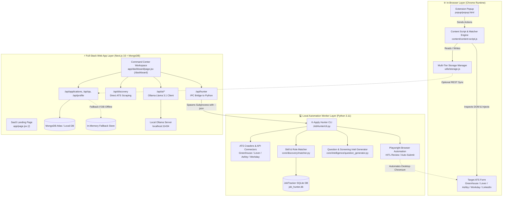

# 🏛️ K-Apply System Architecture & Engineering Blueprint

This document details the high-level architecture, module decomposition, inter-process communication (IPC) protocols, and operational workflows of **K-Apply**.

---

## 1. High-Level System Overview

K-Apply is organized into **Three Unified Pillars** operating across the browser runtime, the local operating system, and the web command center:



---

## 2. The Three Architectural Pillars

| Component                           | Technology Stack                                                 | Primary Responsibility                                                                                                                                                                          | Directory                                                                                                   |
| :---------------------------------- | :--------------------------------------------------------------- | :---------------------------------------------------------------------------------------------------------------------------------------------------------------------------------------------- | :---------------------------------------------------------------------------------------------------------- |
| **Pillar 1: K-Apply Extension**     | Manifest V3, Vanilla ES Modules, Chrome Storage API              | In-browser 1-click form autofill, React synthetic event simulation, dynamic placeholder interpolation, manual slide-out Q&A drawer.                                                             | [`/content`](../content), [`/popup`](../popup), [`/utils`](../utils) |
| **Pillar 2: K-Apply Hunter**        | Python 3.11, Playwright, BeautifulSoup4, Rich, SQLite            | Autonomous career board discovery, candidate match scoring (0-100%), predictive screening question generation, desktop browser autofill with Human-in-the-Loop (HITL) review.                   | [`/JobHunter`](../JobHunter)                                                                   |
| **Pillar 3: Command Center & SaaS** | Next.js 16 (App Router), React 19, Tailwind CSS, MongoDB, Ollama | Mission control dashboard: interactive Kanban pipeline, live ATS radar, local LLM cover letter pitch studio, Q&A knowledge vault, candidate profile manager, and public marketing landing page. | [`/web-dashboard`](../web-dashboard)                                                           |

---

## 3. Communication Protocols & Inter-Process Bridges

### A. Next.js to Python Worker IPC Bridge (`/api/hunter`)

The Web Dashboard communicates directly with the Python automation module without requiring a persistent daemon:

1. When a user clicks **"Run Autonomous Hunter Scan"** or **"Playwright HITL"** in `/dashboard`, a `POST` request is dispatched to `/api/hunter`.
2. The Next.js API route constructs an argument vector (e.g. `['hunt', '--company', 'stripe', '--role', 'Full Stack', '--json']`).
3. Node's `child_process.execFile` executes `python cli.py` within the local `JobHunter/` directory.
4. Structured JSON output is returned over `stdout`, parsed, and rendered in the dashboard UI within milliseconds.
5. For desktop browser automation (`action: 'playwright'`), Node uses `child_process.spawn` with `detached: true` and `child.unref()`, allowing the Playwright browser window to open on the user's desktop while the HTTP request returns an immediate confirmation.

### B. Extension to Active Tab Script Messaging

1. The extension popup (`popup/popup.js`) queries `chrome.tabs.query({ active: true, currentWindow: true })`.
2. It sends `GET_JOB_DETAILS` to the content script (`content/content-script.js`).
3. The content script runs metadata extraction heuristics (`utils/extractor.js`), parsing `<meta>`, OpenGraph tags, JSON-LD schemas, and heading structures to detect company, role title, and location.
4. When the user clicks **"Autofill Application"**, the popup sends `AUTOFILL_FORM`.
5. The content script invokes `AutofillEngine.autofill()` to match and populate inputs in isolated `try/catch` sandboxes.

### C. Extension to Web Dashboard REST Sync

1. The extension's storage manager (`utils/storage.js`) can optionally post saved applications and custom Q&A entries to `http://localhost:3000/api/applications`.
2. To ensure zero browser latency, all outbound HTTP calls are wrapped with an `AbortController` timeout (2000ms), falling back silently to local storage if the web server is offline.

---

## 4. Key Architectural Patterns & Resilience

### 1. React Synthetic Value Setter Bypass

Modern web frameworks (React 16+, Vue 3) track input state via internal property descriptors (e.g., `_valueTracker`). Simply setting `input.value = "..."` updates the DOM node but fails to notify the framework's internal virtual DOM, causing the field to wipe on submit.

- **K-Apply's Solution:**
  ```javascript
  const nativeSetter = Object.getOwnPropertyDescriptor(
    window.HTMLInputElement.prototype,
    "value",
  ).set;
  nativeSetter.call(element, interpolatedValue);
  element.dispatchEvent(new Event("input", { bubbles: true }));
  element.dispatchEvent(new Event("change", { bubbles: true }));
  ```

### 2. Multi-Tier Resilient Storage Architecture

Data persists across three fault-tolerant tiers:

- **Tier 1:** `chrome.storage.local` (active extension environment)
- **Tier 2:** `window.localStorage` (web and local page fallback)
- **Tier 3:** In-Memory dictionary cache (sandboxed iframe or restricted contexts)

### 3. Serverless Connection Caching & Offline DB Fallback

In `web-dashboard/lib/mongodb.js`, the MongoDB client connection is cached globally (`global._mongoClientPromise`) to prevent connection starvation during Next.js Hot Module Replacement (HMR).
If `MONGODB_URI` is unconfigured or the database cluster is temporarily unreachable, all CRUD operations transparently route to an in-memory mock store pre-seeded with candidate data, guaranteeing zero 500 errors.

---

## 5. Directory Map

```
K-Apply/
├── manifest.json              # Chrome Manifest V3 Extension Configuration
├── JobUtils.md                # Blank answer template (fill in your own)
├── background/                # Chrome Service Worker (Navigation & Life-Cycle)
├── content/                   # Content scripts, Matcher, and Floating Drawer
├── popup/                     # In-Browser Toolbar Popup
├── dashboard/                 # Local Standalone Extension Dashboard
├── utils/                     # React prototype setters, Metadata Extractor, Storage
├── docs/                      # Complete System Architecture & Reference Guides
│   ├── ARCHITECTURE.md        # This Document
│   ├── EXTENSION_INTERNALS.md # Chrome Extension In-Depth
│   ├── AUTONOMOUS_HUNTER.md   # Python Automation Module In-Depth
│   ├── COMMAND_CENTER_AND_API.md # Next.js SaaS & REST API Specs
│   └── DATA_FLOW_AND_SECURITY.md # Privacy, Storage & Security Model
├── web-dashboard/             # Next.js 16 SaaS Product & Full Command Center
│   ├── app/                   # App Router: Landing Page (/), Workspace (/dashboard), APIs
│   ├── lib/                   # Database operations, CORS, Ollama AI Service
│   └── data/                  # Seed datasets
└── JobHunter/                 # Autonomous Job Discovery & Question Intelligence Engine
    ├── cli.py                 # Multi-command CLI runner
    ├── core/                  # Discovery crawlers, Question generator, Playwright engine
    └── ui/                    # FastAPI server & Streamlit dashboard
```
