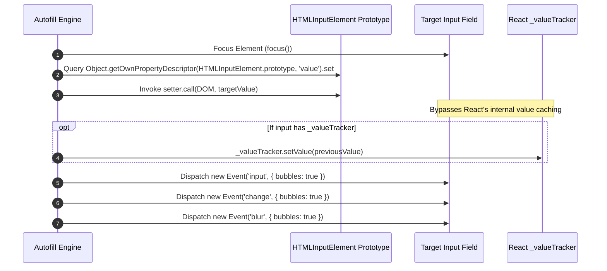

# 🎯 ATS Field Mappings, Detection Heuristics & Form Automation

This document provides the technical field taxonomy, DOM matching heuristics, regex dictionaries, and event injection specifications implemented in the **K-Apply Autofill Engine** across major Applicant Tracking Systems (ATS).

---

## 1. Supported ATS Platforms & Selectors

| ATS Platform | Signature Domain / Path | Main Form Selector | Job Title Selector | Company Selector |
| :--- | :--- | :--- | :--- | :--- |
| **Greenhouse** | `boards.greenhouse.io/*`, `#embedded_job_board` | `form#application_form`, `#embedded_job_board form` | `.app-title`, `h1.app-title`, `.job-title` | `.company-name`, `#header .company-name`, URL segment |
| **Lever** | `jobs.lever.co/*` | `form#application-form`, `.application-form` | `.posting-headline h2` | `.main-header-logo img[alt]`, URL segment |
| **Ashby** | `jobs.ashbyhq.com/*` | `form[class*="applicationForm"]`, `form` | `h1` | URL segment / header brand |
| **Workday** | `*.myworkdayjobs.com/*`, `workday.com` | `[data-automation-id="applicationForm"]` | `[data-automation-id="jobPostingHeader"]`, `[data-automation-id="jobTitle"]` | Subdomain or `[data-automation-id="jobPostingLocation"]` parent |
| **LinkedIn Easy Apply** | `linkedin.com/jobs/*` | `.jobs-easy-apply-modal, .jobs-apply-form` | `.job-details-jobs-unified-top-card__job-title` | `.job-details-jobs-unified-top-card__company-name` |
| **Taleo / Oracle** | `*.taleo.net/*` | `form#requisitionDescriptionInterface` | `.titlelink`, `.desc-title` | Organization banner / cookie |
| **BambooHR** | `*.bamboohr.com/careers/*` | `form.fabric-form` | `h2.jss-` | `.logo img` or subdomain |

---

## 2. Multi-Signal Matching Scoring Matrix

The autofill engine assesses form fields using a weighted scoring model across five distinct DOM attributes:

$$\text{Field Score} = w_{\text{autocomplete}} \cdot S_{\text{auto}} + w_{\text{id}} \cdot S_{\text{id}} + w_{\text{name}} \cdot S_{\text{name}} + w_{\text{label}} \cdot S_{\text{label}} + w_{\text{placeholder}} \cdot S_{\text{ph}}$$

### Signal Weights

```text
[Highest Priority]
  1. Standard HTML5 Autocomplete Attribute (Weight: 100)
  2. <label for="..."> Text Content        (Weight: 80)
  3. Aria-label / Aria-labelledby Text     (Weight: 75)
  4. Form Input 'id' Attribute             (Weight: 60)
  5. Form Input 'name' Attribute           (Weight: 50)
  6. Input 'placeholder' Text              (Weight: 40)
[Lowest Priority]
```

A field must exceed a cumulative threshold of **$\ge 40$** to trigger automatic population.

---

## 3. Field Taxonomy & Regex Pattern Dictionary

The table below outlines the core field patterns defined in `content/matcher.js`:

```javascript
export const PROFILE_PATTERNS = {
  // --- Personal & Contact ---
  firstName: {
    keys: ['first name', 'firstname', 'given-name', 'fname', 'first_name', 'first'],
    autocomplete: ['given-name']
  },
  lastName: {
    keys: ['last name', 'lastname', 'family-name', 'lname', 'last_name', 'surname'],
    autocomplete: ['family-name']
  },
  fullName: {
    keys: ['full name', 'fullname', 'your name', 'candidate name', 'applicant name', 'name'],
    autocomplete: ['name']
  },
  email: {
    keys: ['email', 'email address', 'e-mail', 'contact email', 'emailaddress'],
    autocomplete: ['email'],
    type: 'email'
  },
  phone: {
    keys: ['phone', 'phone number', 'mobile', 'cell', 'telephone', 'contact number', 'phone_number'],
    autocomplete: ['tel'],
    type: 'tel'
  },

  // --- Professional Footprint ---
  linkedin: {
    keys: ['linkedin', 'linkedin profile', 'linkedin url', 'linked in', 'linkedin profile url'],
    urlMatch: 'linkedin.com'
  },
  github: {
    keys: ['github', 'github profile', 'github url', 'git profile', 'github repo'],
    urlMatch: 'github.com'
  },
  portfolio: {
    keys: ['portfolio', 'portfolio url', 'personal website', 'website', 'personal site', 'online portfolio', 'link to your work', 'blog'],
    autocomplete: ['url']
  },

  // --- Address & Demographics ---
  city: {
    keys: ['city', 'current city', 'town'],
    autocomplete: ['address-level2']
  },
  state: {
    keys: ['state', 'province', 'region'],
    autocomplete: ['address-level1']
  },
  country: {
    keys: ['country', 'residence country', 'nationality'],
    autocomplete: ['country', 'country-name']
  },
  postalCode: {
    keys: ['postal code', 'zip', 'zipcode', 'pincode', 'postal'],
    autocomplete: ['postal-code']
  },
  address: {
    keys: ['address', 'street address', 'location', 'current address', 'where do you live'],
    autocomplete: ['street-address']
  },

  // --- Professional Experience & Compensation ---
  currentRole: {
    keys: ['current role', 'current title', 'current position', 'job title', 'recent role', 'what is your role']
  },
  currentCompany: {
    keys: ['current company', 'current employer', 'company name', 'most recent employer']
  },
  yearsOfExperience: {
    keys: ['years of experience', 'total experience', 'yoe', 'years experience', 'how many years']
  },
  noticePeriod: {
    keys: ['notice period', 'availability', 'how soon can you start', 'start date', 'available start', 'joining time']
  },
  expectedSalary: {
    keys: ['expected salary', 'desired salary', 'salary expectation', 'compensation expectation', 'target compensation']
  },
  currentSalary: {
    keys: ['current salary', 'current compensation', 'current ctc']
  },

  // --- Academic Background ---
  degree: {
    keys: ['degree', 'highest degree', 'education level', 'qualification', 'degree name']
  },
  university: {
    keys: ['university', 'college', 'school', 'institution', 'institute']
  },
  graduationYear: {
    keys: ['graduation year', 'grad year', 'year of graduation', 'completion year']
  },
  gpa: {
    keys: ['gpa', 'grades', 'percentage', 'cgpa', 'grade point']
  },

  // --- Work Authorization & Legal ---
  authorizedToWork: {
    keys: ['authorized to work', 'legally authorized', 'work authorization', 'eligible to work', 'legal right to work']
  },
  requiresSponsorship: {
    keys: ['require sponsorship', 'need sponsorship', 'visa sponsorship', 'future sponsorship', 'will you require sponsorship']
  },

  // --- Equal Opportunity (EEOC) ---
  gender: {
    keys: ['gender', 'sex', 'gender identity']
  },
  race: {
    keys: ['race', 'ethnicity', 'demographic', 'racial background']
  },
  veteranStatus: {
    keys: ['veteran', 'veteran status', 'military service', 'protected veteran']
  },
  disabilityStatus: {
    keys: ['disability', 'disability status', 'handicapped', 'physical disability']
  }
};
```

---

## 4. React `_valueTracker` & DOM Event Injection Bypass

Modern ATS forms (leveraging React, Angular, or Vue) intercept native DOM manipulations. Setting `element.value = "John"` directly fails because React maintains an internal state mirror and ignores value changes that do not invoke synthetic event dispatches.

### Injection Engine Protocol



### Reference Implementation (`utils/events.js`)

```javascript
export function setNativeValue(element, value) {
  const valueSetter = Object.getOwnPropertyDescriptor(element.__proto__, 'value')?.set ||
                      Object.getOwnPropertyDescriptor(window.HTMLInputElement.prototype, 'value')?.set ||
                      Object.getOwnPropertyDescriptor(window.HTMLTextAreaElement.prototype, 'value')?.set;

  if (valueSetter) {
    valueSetter.call(element, value);
  } else {
    element.value = value;
  }

  // Clear React 16/17/18 internal tracker
  const tracker = element._valueTracker;
  if (tracker) {
    tracker.setValue(value + '_dirty');
  }

  // Synthesize standard browser event chain
  element.dispatchEvent(new Event('input', { bubbles: true }));
  element.dispatchEvent(new Event('change', { bubbles: true }));
  element.dispatchEvent(new Event('blur', { bubbles: true }));
}
```

---

## 5. Select & Radio Group Heuristics

For dropdown (`<select>`) and radio button inputs (e.g., Work Authorization, Gender, Disability):

1. **Option Value Matching**: Compare candidate value against `<option>` text and `value` attribute.
2. **Fuzzy Normalization**:
   - `Yes` matches `["yes", "true", "authorized", "1", "i am"]`
   - `No` matches `["no", "false", "not authorized", "0", "will not", "do not"]`
   - `Decline` matches `["decline", "prefer not to answer", "choose not to disclose", "wish not to say"]`
3. **Dispatch**: Trigger `new Event('change', { bubbles: true })` on `<select>` or call `.click()` on matching `<input type="radio">`.

---

## 6. Dynamic Template Interpolation Dictionary

K-Apply supports dynamic string interpolation across cover letters, cold emails, and pitch answers.

| Dynamic Token | Description | Fallback Resolution |
| :--- | :--- | :--- |
| `{{company_name}}` | Detected hiring organization name | `the company` |
| `{{role}}` | Detected job opening title | `this position` |
| `{{recruiter_name}}` | Recruiter or hiring manager name | `Hiring Team` |
| `{{portfolio_url}}` | Candidate portfolio website link | *(from your profile)* |
| `{{job_url}}` | Active application URL | Current `window.location.href` |
| `{{full_name}}` | Candidate legal full name | *(from your profile)* |

---

## 7. Metadata Extraction Architecture (`utils/extractor.js`)

To populate dynamic template variables and record applications, the extractor executes in order:

1. **Schema.org JSON-LD Parser**: Inspects `<script type="application/ld+json">` for `@type: "JobPosting"`. Extracts canonical title, organization name, and hiring location.
2. **ATS-Specific DOM Querying**: Evaluates platform rules (e.g. Greenhouse `#embedded_job_board`, Lever `.posting-headline h2`, Workday `[data-automation-id="jobTitle"]`).
3. **OpenGraph & Meta Fallbacks**: Evaluates `meta[property="og:title"]` and `meta[property="og:site_name"]`.
4. **Document Title Parsing**: Evaluates standard format expressions:
   - `[Role] at [Company]`
   - `[Company] - [Role]`
   - `[Role] | [Company] Careers`
5. **First Heading Fallback**: Queries first visible `<h1>` tag with character length `< 90`.
