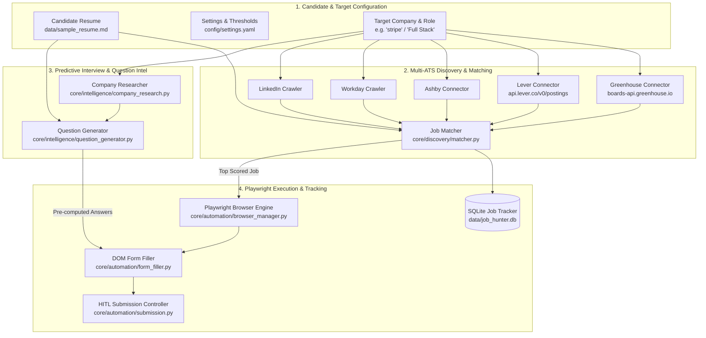
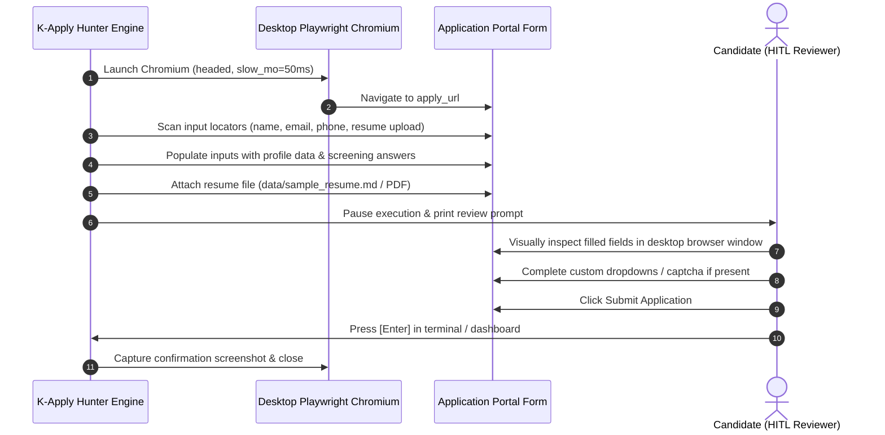

# 🎯 K-Apply Hunter - Autonomous Automation & Question Intelligence

This document details the architecture, crawling engine, interview intelligence generator, and Playwright automation pipeline of **K-Apply Hunter** ([`JobHunter/`](../JobHunter)).

---

## 1. Hunter Architecture Overview

K-Apply Hunter is a Python 3.11 autonomous background engine that discovers job openings across public ATS APIs, scores candidates against live postings, pre-computes interview question intelligence, and drives browser automation.



---

## 2. Multi-ATS Crawlers & API Connectors

K-Apply Hunter connects directly to official public endpoints rather than fragile HTML scrapers whenever possible:

### 1. Greenhouse Connector (`core/discovery/greenhouse_api.py`)

- **Endpoint:** `https://boards-api.greenhouse.io/v1/boards/{company_slug}/jobs?content=true`
- **Protocol:** HTTPS RESTful JSON
- **Capabilities:** Retrieves complete job listings, HTML job descriptions, department classifications, office locations, and direct application URLs.

### 2. Lever Connector (`core/discovery/lever_api.py`)

- **Endpoint:** `https://api.lever.co/v0/postings/{company_slug}?mode=json`
- **Protocol:** HTTPS RESTful JSON
- **Capabilities:** Extracts posting categories, employment types (full-time, contract), team designations, and required qualifications.

### 3. Ashby Connector (`core/discovery/ashby_api.py`)

- **Protocol:** Public Ashby job board queries.

### 4. Workday & LinkedIn Crawlers (`core/discovery/`)

- **Protocol:** Playwright-based headless and headed crawlers for multi-tenant Workday subdomains (`*.myworkdayjobs.com`) and public job posts.

---

## 3. Resume Scoring & Matching Engine (`matcher.py`)

K-Apply Hunter ranks discovered jobs from **0% to 100% compatibility** using candidate skills indexed from their resume (`ProfileManager`):

```python
class JobMatcher:
    def score_job(self, job: dict) -> Tuple[int, dict]:
        # 1. Title alignment against target role
        title_score = self._compute_title_similarity(job["title"], self.target_role)

        # 2. Skill presence in job description
        matched_skills, missing_skills = self._extract_matching_skills(job["content"])
        skill_score = (len(matched_skills) / max(len(self.candidate_skills), 1)) * 100

        # 3. Weighted composite
        composite_score = int((title_score * 0.45) + (skill_score * 0.55))
        return min(max(composite_score, 0), 100), {
            "matched_skills": matched_skills,
            "missing_skills": missing_skills
        }
```

---

## 4. Predictive Question Intelligence (`question_generator.py`)

Before the candidate applies, K-Apply Hunter generates a comprehensive **Intelligence & Interview Prep Pack**:

1. **Company Profile & Cultural Memo**:
   - Evaluates company mission, domain (e.g. Fintech, Cloud, Developer Tools), core values (e.g. _"Users first"_, _"Move fast"_), and known interview styles (e.g. _"Hands-on coding in own editor, API design"_).
2. **Pre-Computed Application Screening Answers**:
   - Answers common open-ended form fields tailored to the candidate's resume:
     - _Why do you want to join this company?_
     - _Describe your relevant technical experience for this role._
     - _Salary expectations & notice period._
     - _Work authorization & visa sponsorship._
3. **Top Frequently Asked Interview Questions**:
   - Curates the top technical (architecture, API design, DevOps) and behavioral (conflict resolution, production incidents) questions with strategy tips.
4. **STAR Experience Bullets**:
   - Formats candidate achievements into **Situation, Task, Action, and Result** bullets ready for technical screening calls.

---

## 5. Playwright Desktop Automation & HITL Review Mode

To prevent accidental submissions or inaccurate entries, K-Apply Hunter introduces **Human-in-the-Loop (HITL) Review Mode**:



---

## 6. CLI Command Reference

K-Apply Hunter can be invoked directly from the terminal or through the Web Dashboard IPC bridge:

### 1. `hunt`: Scan Boards & Score Jobs

```bash
# Scan Greenhouse board for Stripe openings matching Full Stack Engineer
python cli.py hunt --company stripe --portal greenhouse --role "Full Stack Engineer"

# Scan and output machine-readable JSON (used by Next.js Dashboard API)
python cli.py hunt --company figma --portal greenhouse --role "Frontend Engineer" --json

# Scan and immediately launch Playwright autofill on the top match
python cli.py hunt --company stripe --portal greenhouse --role "Full Stack" --autofill --mode review
```

### 2. `intel`: Standalone Question Intelligence

```bash
# Generate interview questions and screening answers for Stripe
python cli.py intel --company stripe --role "Full Stack Engineer"

# Output structured JSON
python cli.py intel --company stripe --role "Full Stack Engineer" --json
```

### 3. `apply`: Direct URL Autofill

```bash
# Launch Playwright to fill a specific job application link in review mode
python cli.py apply --url "https://boards.greenhouse.io/stripe/jobs/5910244" --role "Full Stack Engineer" --mode review
```

### 4. `list`: Query Saved Database

```bash
# List discovered jobs from SQLite tracker
python cli.py list --min-score 70
```
