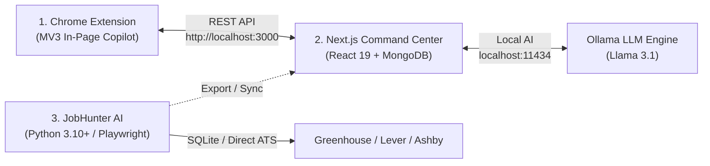

# ⚙️ Configuration, Setup & Operations Guide

This guide walks you through setting up and running all three pillars of the **K-Apply Suite**:
1. **Chrome Autofill Extension** (Browser Copilot & In-Page Side Drawer)
2. **Next.js Command Center** (Web Dashboard, MongoDB, and Ollama AI Proxy)
3. **JobHunter Autonomous Engine** (Playwright CLI, ATS Crawlers & Match Scoring)

---

## 1. Quick Architecture Overview



---

## 2. Pillar 1: Chrome Extension Setup

The Chrome extension monitors job portals, detects forms, injects native value changes (bypassing React's `_valueTracker`), and renders the in-page **Side Drawer** showing filled and skipped fields.

### Installation Steps
1. Open Google Chrome and navigate to `chrome://extensions/`.
2. Toggle **Developer mode** in the top-right corner to **ON**.
3. Click **Load unpacked** in the top-left toolbar.
4. Select the project root folder (the directory containing `manifest.json`).
5. Pin **K-Apply** to your Chrome toolbar for 1-click access.

### Verifying Content Script Injection
1. Navigate to any ATS application page (e.g. `https://boards.greenhouse.io/...` or `https://jobs.lever.co/...`).
2. Observe the draggable **⚡ K-Apply** floating launcher button in the bottom-right corner.
3. Click **Autofill Application**: the side drawer will slide open with the audit breakdown of all **Filled** and **Skipped** fields.

---

## 3. Pillar 2: Next.js Command Center (`web-dashboard`)

The full-stack Command Center provides the Kanban application pipeline, candidate profile editor, Q&A Knowledge Vault, and Ollama AI cover letter generation.

### Prerequisites
* Node.js v18.17+ or v20+
* MongoDB Atlas connection string (or local MongoDB on port 27017)
  *(Note: An in-memory fallback will automatically activate if MongoDB is unconfigured)*

### Setup Instructions
1. Open a terminal in `web-dashboard`:
   ```bash
   cd web-dashboard
   ```
2. Copy environment file:
   ```bash
   cp .env.example .env.local
   ```
3. Configure `.env.local`:
   ```env
   # MongoDB Connection
   MONGODB_URI=mongodb://localhost:27017/kapply
   MONGODB_DB=kapply

   # Ollama Local AI Engine
   OLLAMA_BASE_URL=http://localhost:11434
   OLLAMA_MODEL=llama3.1

   # Server Port
   PORT=3000
   ```
4. Install dependencies:
   ```bash
   npm install
   ```
5. Start development server:
   ```bash
   npm run dev
   ```
   Or run the root launcher on Windows:
   ```cmd
   start-dashboard.bat
   ```
6. Open your browser at `http://localhost:3000`.

### 1-Click Database Seeding
1. In the Command Center sidebar, navigate to **Database & Sync**.
2. Click **"Initialize Missing Data"** (or **"Force Re-Seed"**).
3. The collections `profile`, `qa`, and `applications` will be seeded from the blank templates in `web-dashboard/data/seed-data.js`. Fill in your own details afterward.

---

## 4. Pillar 3: JobHunter Autonomous Engine (`JobHunter`)

The backend crawler and headless Playwright engine that queries job boards, computes resume match scores, and automates multi-step submissions.

### Prerequisites
* Python 3.10+
* Virtual environment (`venv` or `conda`)

### Setup Instructions
1. Open a terminal in `JobHunter`:
   ```bash
   cd JobHunter
   ```
2. Create and activate a Python virtual environment:
   ```bash
   # Windows PowerShell
   python -m venv venv
   .\venv\Scripts\Activate.ps1
   ```
3. Install dependencies:
   ```bash
   pip install -r requirements.txt
   playwright install chromium
   ```
4. Configure target roles and locations in `JobHunter/config/settings.yaml`:
   ```yaml
   defaults:
     target_role: "Full Stack Engineer"
     locations:
       - "Remote"
       - "United States"
       - "India"
     min_match_score: 50
   
   app:
     default_mode: "review" # "review" for Human-in-the-Loop review, or "auto"
     headless_browser: false # Watch Playwright fill forms in real-time
   ```

### Execution Commands
```bash
# Discover new job postings from Ashby, Greenhouse, Lever
python cli.py discover

# Compute resume match score for discovered jobs
python cli.py match

# Launch interactive Human-in-the-Loop application runner
python cli.py apply --mode review

# Launch the JobHunter Web UI
python ui/server.py
```

---

## 5. Local AI Engine Setup: Ollama (`localhost:11434`)

K-Apply uses Ollama to answer screening questions and craft tailored cover letters with zero cloud telemetry.

1. Download and install Ollama from [ollama.com](https://ollama.com).
2. Pull the recommended high-performance open model:
   ```bash
   ollama pull llama3.1
   ```
3. Verify Ollama is listening locally:
   ```bash
   curl http://localhost:11434/api/tags
   ```
4. In the K-Apply Chrome side drawer, click **✨ AI Cover Letter (Ollama)** to generate tailored pitches dynamically!
