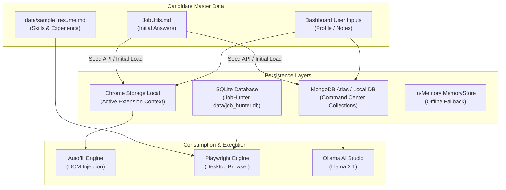

# 🔒 K-Apply Data Flow, Privacy & Security Architecture

This document describes the privacy model, data storage schemas, backup mechanisms, and security guardrails across the **K-Apply Suite**.

---

## 1. Privacy-First Security Principles

Unlike typical job-hunting extensions that sell candidate telemetry or upload resumes to third-party cloud servers, **K-Apply is engineered strictly privacy-first**:

1. **Zero External Telemetry**:
   * K-Apply does not track analytics, user keystrokes, or job application activity to external tracking servers.
2. **Local AI Execution**:
   * All AI pitch generation and question answering communicates directly with your **local Ollama instance (`localhost:11434`)** running models like `llama3.1`. Sensitive compensation requirements and career details never leave your hardware.
3. **No Third-Party Cloud Data Brokers**:
   * Application status, interview dates, and personal answers remain confined to your local Chrome storage and your private MongoDB database.

---

## 2. Data Flow Architecture



---

## 3. Storage Schemas & Data Models

### A. MongoDB / Command Center Schemas

#### 1. `applications` Collection
```json
{
  "_id": "ObjectId('66f5...)",
  "id": "app_1727400000000",
  "company": "Stripe",
  "role": "Staff Infrastructure Engineer",
  "location": "Remote / Seattle, WA",
  "url": "https://boards.greenhouse.io/stripe/jobs/5910244",
  "status": "applied", 
  "dateApplied": "2026-09-27",
  "salary": "$175,000 - $210,000",
  "matchScore": 96,
  "notes": "Applied with K-Apply tailored pitch.",
  "createdAt": "2026-09-27T00:00:00.000Z",
  "updatedAt": "2026-09-27T00:00:00.000Z"
}
```
* **Allowed `status` values:** `wishlist`, `applied`, `interviewing`, `offer`, `rejected`

#### 2. `qa` Collection (Knowledge Vault)
```json
{
  "_id": "ObjectId('66f5...)",
  "id": "qa_7",
  "title": "Production Issue Faced and Fixed",
  "category": "Technical & Production",
  "triggerKeywords": ["incident", "production bug", "outage", "challenge", "failure"],
  "answer": "Diagnosed React synthetic event bubbling and memory leaks in real-time dashboards...",
  "isTemplate": false,
  "createdAt": "2026-09-27T00:00:00.000Z"
}
```

#### 3. `profile` Collection (Candidate Master Profile)
```json
{
  "_id": "ObjectId('66f5...)",
  "personal": {
    "fullName": "",
    "headline": "",
    "email": "",
    "phone": "",
    "location": ""
  },
  "links": {
    "linkedin": "",
    "github": "",
    "portfolio": ""
  },
  "preferences": {
    "salaryExpectation": "",
    "noticePeriodWeeks": 0,
    "workAuthorization": ""
  },
  "skills": []
}
```

> All values ship blank. K-Apply never includes candidate data in the repository.

---

### B. SQLite Hunter Schema (`JobHunter/data/job_hunter.db`)

Managed by `JobTrackerDB` (`core/tracker/db.py`):
```sql
CREATE TABLE IF NOT EXISTS jobs (
    id INTEGER PRIMARY KEY AUTOINCREMENT,
    company TEXT NOT NULL,
    portal TEXT NOT NULL,
    title TEXT NOT NULL,
    location TEXT,
    apply_url TEXT UNIQUE,
    match_score INTEGER DEFAULT 0,
    status TEXT DEFAULT 'ready_to_apply',
    discovered_at TIMESTAMP DEFAULT CURRENT_TIMESTAMP
);
```

---

## 4. Backup, Export & Disaster Recovery

K-Apply ensures you maintain full sovereignty over your career records:

1. **1-Click JSON Full Backup**:
   * Available in both the Chrome Extension Dashboard (`Data & Backup` tab) and the Web Command Center (`Cloud Sync` tab).
   * Bundles all active applications, custom Q&A answers, and profile settings into a single timestamped JSON file:
     ```text
     k-apply-backup-2026-09-27.json
     ```
2. **1-Click JSON Restore**:
   * Uploading a backup JSON instantly validates schema structure and repopulates all local or MongoDB collections.
3. **CSV Export for Spreadsheets**:
   * Exports all pipeline records directly to CSV formatted for Google Sheets, Microsoft Excel, or Notion databases.
