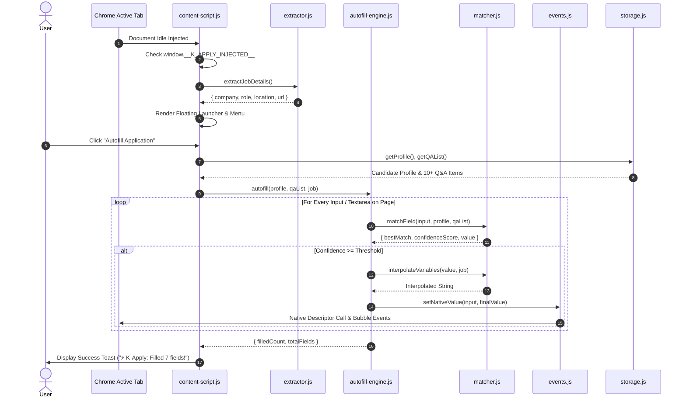

# ⚡ K-Apply Extension Internals & DOM Automation

This document provides a technical deep-dive into the **K-Apply Manifest V3 Chrome Extension** (`content/`, `popup/`, `utils/`, `dashboard/`).

---

## 1. Manifest V3 Architecture

The extension is configured in [`manifest.json`](../manifest.json) using standard Manifest V3 specifications with zero external bundler requirements (pure native ES modules):

- **Service Worker (`background/service-worker.js`)**: Handles extension installation life-cycle, context menu actions, and tab change events.
- **Content Scripts (`content/content-script.js`, `content/floating-widget.css`)**: Injected into web pages at `document_idle`.
- **Permissions**:
  - `storage`: Enables persistent profile, Q&A, and tracked applications storage via `chrome.storage.local`.
  - `activeTab`: Grants temporary elevated access to inspect the active job application tab without broad host permissions.
  - `scripting`: Allows dynamic script execution when needed.
- **Web Accessible Resources**: Exposes ES modules (`utils/*`, `data/*`, `content/*`) so they can be dynamically imported by content scripts.

---

## 2. In-Page Injection & Execution Flow



---

## 3. Form Discovery & Multi-Signal Scoring Engine (`matcher.js`)

Candidate answers and profile fields are matched against HTML form inputs using a weighted multi-signal scoring algorithm:

### Signals Evaluated:

1. **Associated `<label>` text**: Evaluates `for` attribute and enclosing `<label>` elements.
2. **`placeholder` attribute**: Evaluates placeholder guidance.
3. **`name` attribute**: Evaluates field name (e.g. `job_application[first_name]`, `email_address`).
4. **`id` attribute**: Evaluates DOM ID.
5. **`autocomplete` attribute**: Evaluates standard HTML5 autocomplete tags (e.g., `given-name`, `email`, `tel`).
6. **`aria-label` & `aria-describedby`**: Evaluates accessibility annotations.

### Scoring Formula:

$$\text{Score} = w_{\text{autocomplete}} S_{\text{auto}} + w_{\text{name}} S_{\text{name}} + w_{\text{id}} S_{\text{id}} + w_{\text{label}} S_{\text{label}} + w_{\text{ph}} S_{\text{ph}}$$

If an input has high similarity to a profile field (e.g. "Full Name", "Email", "Phone", "LinkedIn", "GitHub", "Salary", "Notice Period"), the field is populated. If it matches a complex behavioral keyword (e.g., "incident", "proud", "exceptional", "why us"), the corresponding pre-loaded Q&A library answer is selected.

---

## 4. Overcoming React Virtual DOM: The Native Value Setter

Modern single-page applications built in React, Vue, or Angular override the HTMLInputElement `value` setter with a property descriptor that binds into internal component state trackers (such as React's `_valueTracker`).

If an extension directly assigns `input.value = "Jane Doe"`, React does not detect that the value changed. When the user interacts with the form or submits, React overwrites the field with its prior state (emptying it).

### Implementation in [`utils/events.js`](../utils/events.js):

```javascript
export function setNativeValue(element, value) {
  const valueSetter = Object.getOwnPropertyDescriptor(element, "value")?.set;
  const prototype = Object.getPrototypeOf(element);
  const prototypeValueSetter = Object.getOwnPropertyDescriptor(
    prototype,
    "value",
  )?.set;

  if (prototypeValueSetter && valueSetter !== prototypeValueSetter) {
    prototypeValueSetter.call(element, value);
  } else if (valueSetter) {
    valueSetter.call(element, value);
  } else {
    element.value = value;
  }

  // Dispatch synthetic bubbles to notify React/Vue virtual DOM
  element.dispatchEvent(new Event("input", { bubbles: true }));
  element.dispatchEvent(new Event("change", { bubbles: true }));
  element.dispatchEvent(new Event("blur", { bubbles: true }));
}
```

---

## 5. Dynamic Variable Interpolation

Templates stored in the Q&A knowledge base (like cover letters, introduction memos, or reasons for change) support contextual variable interpolation:

| Placeholder        | Evaluates To                                   | Source                                |
| :----------------- | :--------------------------------------------- | :------------------------------------ |
| `{{company_name}}` | Active target company (e.g. "Stripe", "Figma") | Extracted from DOM / URL              |
| `{{role}}`         | Target job title (e.g. "Full Stack Engineer")  | Extracted from page `<h1>` / metadata |
| `{{full_name}}`    | Candidate full name                            | Profile Store                         |
| `{{location}}`     | Candidate or Job location                      | Profile / DOM                         |
| `{{job_url}}`      | Active job posting URL                         | `window.location.href`                |

**Example Transformation:**

- **Raw Template:**
  > _"I am excited to apply for the `{{role}}` position at `{{company_name}}`. With deep expertise in distributed architectures..."_
- **Interpolated Output on Stripe posting:**
  > _"I am excited to apply for the Senior Infrastructure Engineer position at Stripe. With deep expertise in distributed architectures..."_

---

## 6. Slide-Out Q&A Knowledge Vault Drawer

When a company's application form uses ambiguous or highly bespoke screening questions that fall below the auto-match confidence threshold:

1. The user clicks **"Browse Q&A Answers"** on the K-Apply floating widget.
2. A sleek slide-out drawer (`#autoapply-drawer-root`) appears on the right side of the active page.
3. The drawer provides instant fuzzy search across all pre-loaded and custom Q&A items.
4. Clicking **"Copy Answer"** interpolates variables for the active company and copies the clean text to the clipboard for instant paste into the form.

---

## 7. Multi-Tier Resilient Storage Architecture (`utils/storage.js`)

To guarantee operation across standard tabs, sandboxed iframes, and local development environments without throwing storage exceptions:

```javascript
class StorageManager {
  async get(key, defaultValue = null) {
    // Tier 1: Chrome Storage Local
    if (
      typeof chrome !== "undefined" &&
      chrome.storage &&
      chrome.storage.local
    ) {
      try {
        const result = await chrome.storage.local.get([key]);
        return result[key] !== undefined ? result[key] : defaultValue;
      } catch (_) {}
    }

    // Tier 2: Window LocalStorage Fallback
    if (typeof window !== "undefined" && window.localStorage) {
      try {
        const item = window.localStorage.getItem(key);
        return item ? JSON.parse(item) : defaultValue;
      } catch (_) {}
    }

    // Tier 3: In-Memory Volatile Store Fallback
    return this.memoryStore[key] !== undefined
      ? this.memoryStore[key]
      : defaultValue;
  }
}
```
